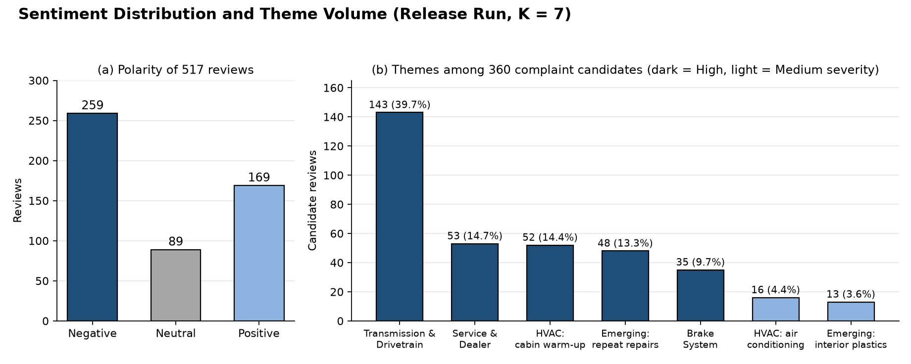
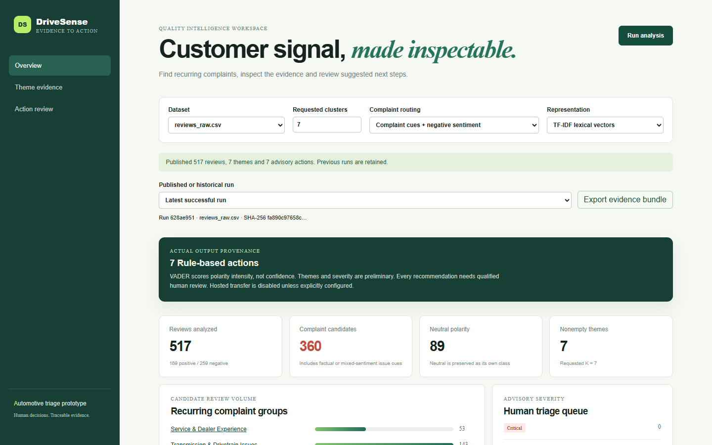
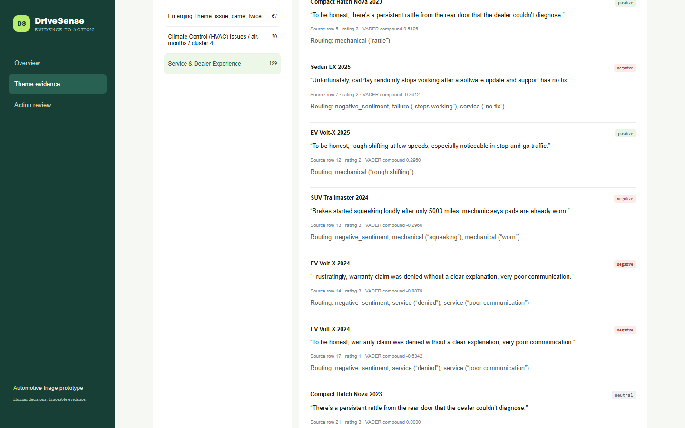
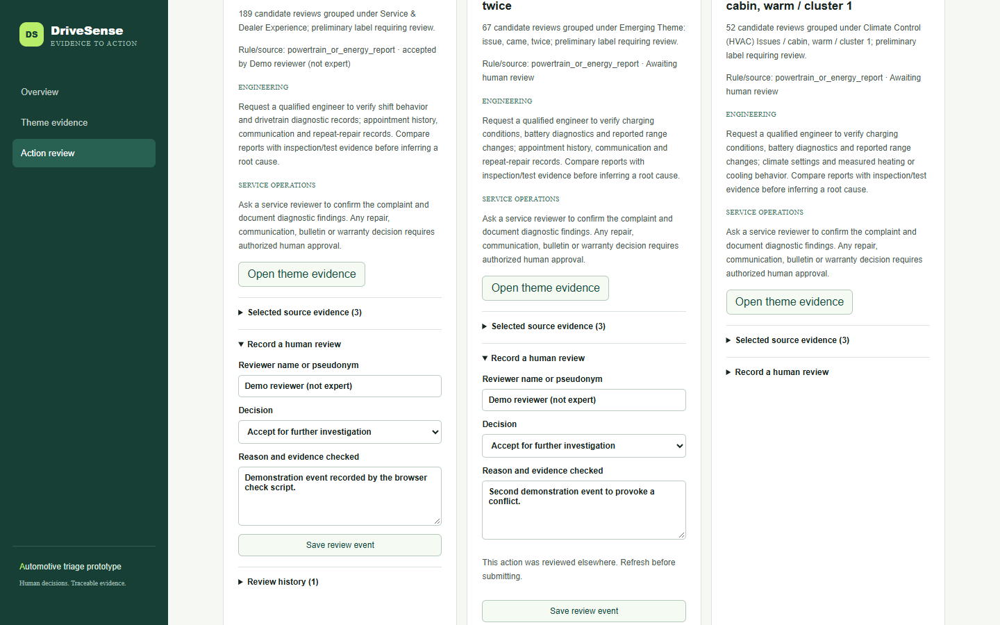
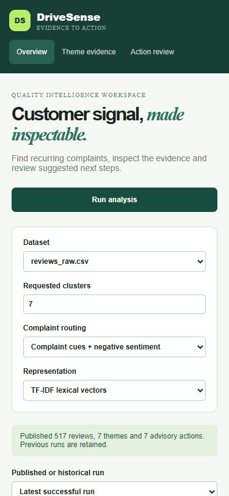
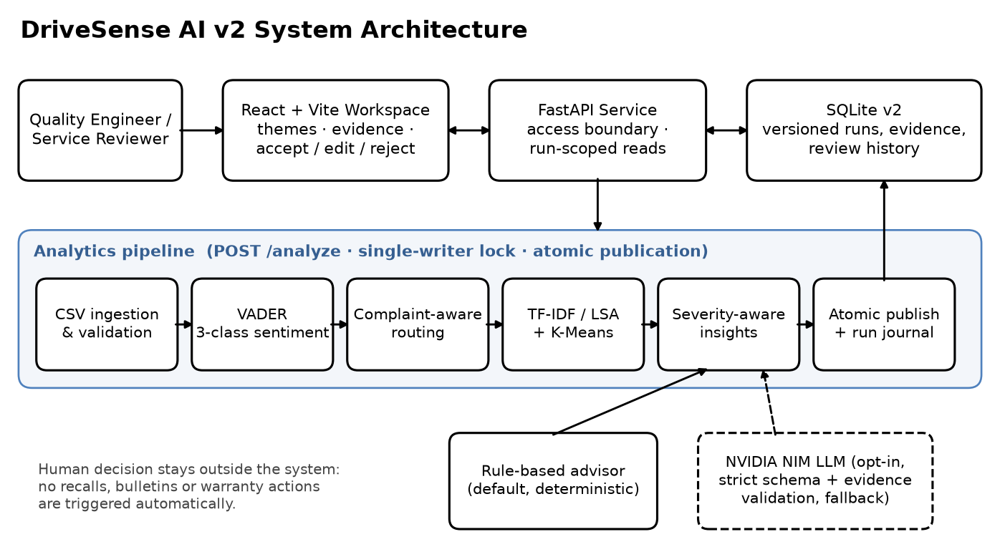
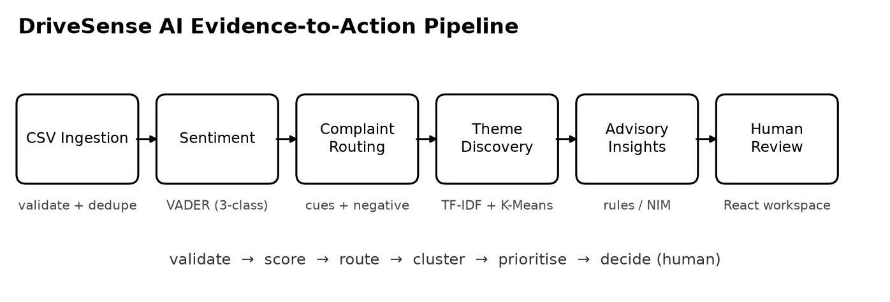

# DriveSense AI

**An explainable Voice-of-Customer analytics platform for automotive quality intelligence.**

[](https://github.com/arshad0501/nvidiartd/actions/workflows/quality.yml)


-76b900)

DriveSense AI turns unstructured vehicle-owner reviews into a short, prioritised list of **recurring complaint themes**, each with a **severity level**, an **engineering recommendation** and a **service recommendation**. Every recommendation stays linked to the exact customer reviews that produced it, and a human reviewer accepts, edits or rejects it before anyone acts.

> DriveSense AI is a **decision-support** tool. It does not diagnose defects or trigger recalls, warranty actions or customer communications.

---

## Highlights

| | |
|---|---|
| **Complaint-aware routing** | Combines VADER sentiment with inspectable complaint cues, so factual complaints written in a neutral tone are not lost. The matched rule and text span are stored as evidence. |
| **Explainable themes** | TF-IDF (or LSA) features with seeded K-Means. Each theme is listed with its keywords, its size and representative reviews. |
| **Evidence-linked advice** | Severity-aware engineering and service recommendations come from a deterministic rule engine. NVIDIA NIM can be enabled instead, with strict schema and evidence validation. |
| **Human-in-the-loop** | Reviewers accept, edit or reject each recommendation in the React workspace. Every decision is stored with its reason and a version number. |
| **Reliable and reproducible** | Each analysis is a versioned run, published atomically, with a hashed input and its configuration recorded. A failed or concurrent run never overwrites the published results. |
| **Verified** | 62 regression tests; 18 end-to-end checks against a live server; 29 browser checks at mobile, tablet and desktop widths; a Docker Compose deployment check; CI on every push. |

## Results (release run, demonstration dataset)

Default configuration: complaint-aware routing, TF-IDF, K = 7, seed 42.

| Metric | Value |
|---|---|
| Raw rows → clean reviews | 603 → 517 (2 invalid, 84 duplicates removed) |
| Sentiment (negative / neutral / positive) | 259 / 89 / 169 |
| Complaint candidates | 360 (259 negative + 101 caught by complaint cues) |
| Recurring themes | 7 (5 High, 2 Medium severity) |
| Routing recall on the synthetic diagnostic | 71.0% (sentiment gate) → **97.6%** (complaint-aware) |
| Regression tests | 62 / 62 pass |
| End-to-end release checks | 18 / 18 pass (live API, history, export, 409 conflicts, 6 injected failures, restart) |
| Browser checks | 29 / 29 pass (375 / 768 / 1440 px, keyboard, reruns, history, review form, export, outage) |
| Runtime for a full analysis | about 1 second on a laptop |



Full results, method and limitations: [`docs/RESULTS.md`](docs/RESULTS.md). How each claim was verified: [`docs/VERIFICATION.md`](docs/VERIFICATION.md).

## The analyst workspace



| Theme evidence | Action review | Mobile |
|---|---|---|
|  |  |  |

## Architecture





| Layer | Technology |
|---|---|
| Ingestion and validation | Python, pandas (bounded CSV parsing, de-duplication, SHA-256 fingerprint) |
| Sentiment | VADER (three classes: positive, neutral, negative) |
| Complaint routing | Rule-based complaint cues plus negative polarity |
| Representation and clustering | scikit-learn TF-IDF (1–2-grams), optional LSA, K-Means |
| Insight generation | Deterministic rule engine; optional NVIDIA NIM (`meta/llama-3.1-70b-instruct`), validated with Pydantic |
| Persistence | SQLite + SQLAlchemy (versioned runs, evidence links, review events) |
| API | FastAPI |
| User interface | React 19 + Vite (Streamlit dashboard kept as an optional alternative) |
| Deployment | Docker Compose, GitHub Actions CI |

## Repository structure

```
.
├── app/
│   ├── api/main.py          # FastAPI service and access boundary
│   ├── core/                # ingestion, sentiment, complaints, clustering, insights, db, pipeline
│   └── dashboard.py         # optional Streamlit dashboard
├── frontend/                # React + Vite analyst workspace
├── data/                    # demonstration dataset, NHTSA sample, generator
├── tests/                   # pytest regression suite (62 tests)
├── experiments/             # pre-registered benchmark protocol and runner
├── evaluation_data/         # blank annotation and expert-review packs
├── scripts/                 # release + browser verification, NHTSA import, annotation tooling
├── docs/                    # results, verification, demo guide, design decisions, images, evidence
├── run_pipeline.py          # command-line entry point
├── docker-compose.yml       # API + workspace containers
└── requirements*.lock       # hash-locked Python dependencies
```

## Getting started

### Prerequisites

- Python **3.12**
- Node.js **22.12 or later** (24 recommended)
- Git

### 1. Clone and install

```bash
git clone https://github.com/arshad0501/nvidiartd.git
cd nvidiartd
python -m venv .venv
```

Windows (PowerShell):

```powershell
.venv\Scripts\activate
pip install -r requirements-dev.lock
```

macOS / Linux:

```bash
source .venv/bin/activate
pip install -r requirements-dev.lock
```

### 2. Run the analysis pipeline

```bash
python run_pipeline.py
```

This prints the run summary (reviews, candidates, themes and insights) and creates `data/drivesense_v2.db`.

Options:

```bash
python run_pipeline.py --csv reviews_raw.csv --clusters 7
python run_pipeline.py --routing negative_only --backend lsa
python run_pipeline.py --csv nhtsa_public_sample.csv
```

### 3. Start the API

```bash
python -m uvicorn app.api.main:app --host 127.0.0.1 --port 8000
```

Interactive API documentation is at http://127.0.0.1:8000/docs.

### 4. Start the analyst workspace (second terminal)

```bash
cd frontend
npm ci
npm run dev
```

Open http://127.0.0.1:5173. You can run an analysis, explore the themes and their evidence, and accept, edit or reject recommendations.

Optional Streamlit dashboard:

```bash
python -m streamlit run app/dashboard.py
```

### Run with Docker

```powershell
./scripts/setup_demo.ps1      # creates .env with a random API token (Windows)
docker compose up --build
```

On macOS or Linux, create `.env` from `.env.example` and set `DRIVESENSE_API_TOKEN` to a random string of at least 24 characters. The workspace is then served at http://127.0.0.1:5173.

## Configuration

| Variable | Default | Purpose |
|---|---|---|
| `DRIVESENSE_DATA_DIR` | `data/` | Folder that input CSVs must come from |
| `DRIVESENSE_DB_PATH` | `data/drivesense_v2.db` | SQLite database location |
| `DRIVESENSE_ACCESS_MODE` | `local` | `local` (loopback only) or `shared` (token required) |
| `DRIVESENSE_API_TOKEN` | — | Bearer token for shared mode (at least 24 characters) |
| `NVIDIA_API_KEY` | — | Enables NVIDIA NIM when combined with the next variable |
| `DRIVESENSE_ALLOW_EXTERNAL` | `0` | Set to `1` to allow review text to be sent to NVIDIA NIM |
| `NVIDIA_MODEL` | `meta/llama-3.1-70b-instruct` | NIM model identifier |
| `NVIDIA_TIMEOUT_SECONDS` | `15` | NIM request timeout (1–60 s) |
| `VITE_API_URL` | `http://127.0.0.1:8000` | API address used by the frontend |

### Enabling NVIDIA NIM

```bash
# Windows PowerShell: $env:NVIDIA_API_KEY="nvapi-..."; $env:DRIVESENSE_ALLOW_EXTERNAL="1"
export NVIDIA_API_KEY=nvapi-...
export DRIVESENSE_ALLOW_EXTERNAL=1
python run_pipeline.py
```

NIM receives only theme statistics, keywords and up to three representative excerpts. Each response must pass a strict schema check and cite evidence from its own theme. On any timeout or invalid output, the system falls back to the rule engine and records the reason.

## Input format

A UTF-8 CSV with the header `vehicle,review_text,rating`. Ratings may be blank; otherwise they must be whole numbers from 1 to 5. Limits are 10 MiB, 20,000 rows and 12,000 characters per review. See [`data/README.md`](data/README.md) for dataset provenance.

## API overview

| Method | Endpoint | Description |
|---|---|---|
| GET | `/health` | Service health |
| GET | `/datasets` | Available input CSVs |
| GET | `/ai/status` | Configured insight provider |
| GET | `/dashboard/snapshot` | Consistent run snapshot (summary, themes, insights) |
| GET | `/dashboard/summary` | Summary metrics |
| GET | `/reviews` | Reviews, filterable by sentiment, theme and run |
| GET | `/themes` | Themes for a run |
| GET | `/insights` | Action records with evidence and review history |
| GET | `/runs` | Run history |
| GET | `/runs/{id}/export` | Full JSON evidence bundle |
| POST | `/analyze` | Run the pipeline and publish a new run |
| POST | `/insights/{id}/review` | Record an accept, edit or reject decision |

## Testing

```bash
python -m pytest
```

The suite covers input validation, path and size limits, sentiment, complaint routing, tiny or empty data, NIM gating and fallback, publication faults, concurrent writers, access control, the review workflow and deployment configuration.

End-to-end checks against a live server, in an isolated temporary database:

```bash
python scripts/verify_release.py
```

Browser checks against a running deployment (optional; needs `pip install playwright==1.55.0` and Google Chrome):

```bash
docker compose up -d
python scripts/browser_check.py --base http://127.0.0.1:5173 --api http://127.0.0.1:5173/api
```

GitHub Actions runs the test suite, the end-to-end verification and the frontend build on every push. A step-by-step demonstration is in [`docs/DEMO.md`](docs/DEMO.md).

## Reproducing the experiments

```bash
python experiments/run_benchmarks.py
```

This follows the pre-registered protocol in [`experiments/protocol.json`](experiments/protocol.json). It compares routing strategies and four text representations across K = 3–12 with three seeds, and writes the results to [`experiments/results/`](experiments/results/). The committed results were reproduced exactly from a clean clone (timings excluded).

## Limitations

- The bundled reviews are synthetic. The diagnostic metrics use labels reconstructed from the data generator, not independent annotations.
- The recommendations have not yet been validated by automotive domain experts. Annotation and expert-review packs are provided in `evaluation_data/`.
- NVIDIA NIM is covered by mocked tests only. NVIDIA NV-Embed is a planned backend for the existing representation interface.
- Automated browser checks do not replace screen-reader testing or studies with real users.
- Severity is a rule-based triage suggestion, not a diagnosis.

Design rationale: [`docs/decisions/`](docs/decisions/).

## Author

**Arshad P** — Department of Computer Science & Engineering, Dayananda Sagar University, Bengaluru.
Built for the *Ready to Deploy – Generative AI & LLM Bootcamp*.
