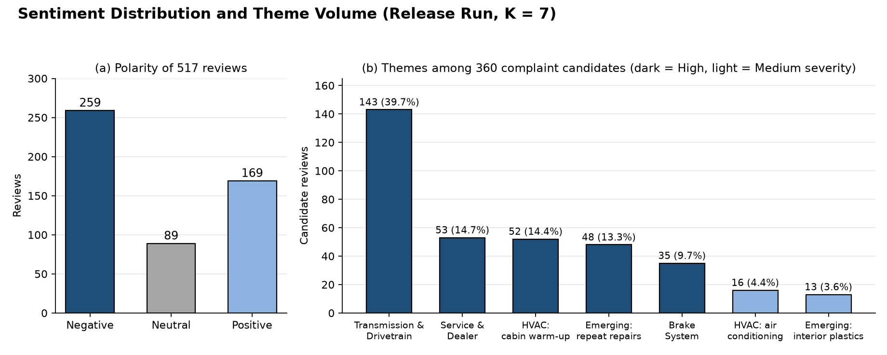
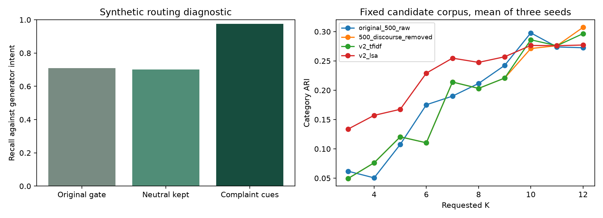

# Results

All results come from the default release run (pipeline version 2.0.0; complaint-aware routing, TF-IDF, K = 7, seed 42) on `data/reviews_raw.csv`. An independent re-run with the same input reproduced every count, theme, keyword and severity exactly.

## 1. Data and sentiment

| Stage | Count |
|---|---|
| Raw rows | 603 |
| Rejected (invalid text) | 2 |
| Duplicates removed | 84 |
| Clean reviews | 517 |
| Negative / neutral / positive (VADER) | 259 / 89 / 169 |
| Complaint candidates | 360 (259 negative + 101 cue-routed) |

## 2. Discovered themes

| Theme | Reviews | Share | Severity | Top keywords |
|---|---:|---:|---|---|
| Transmission & Drivetrain Issues | 143 | 39.7% | High | transmission, shifting, service, stop, rough, gear |
| Service & Dealer Experience | 53 | 14.7% | High | warranty, dealer, claim denied, clear explanation |
| Climate Control (HVAC): cabin warm-up | 52 | 14.4% | High | cabin, warm, mornings, cabin winter, forever warm |
| Emerging theme: repeat repairs | 48 | 13.3% | High | came, months, times, fixed twice |
| Brake System Issues | 35 | 9.7% | High | braking, braking jerky, city driving, inconsistent |
| Climate Control (HVAC): air conditioning | 16 | 4.4% | Medium | air conditioning, blowing cold, conditioning stopped |
| Emerging theme: interior plastics | 13 | 3.6% | Medium | cheap plastic, door panels, panels scratches |

### Example action record

> **Brake System Issues** (35 reviews) · Severity **High** · rule `braking_report`
>
> **Engineering:** Request a qualified engineer to verify braking response, wear and operating conditions. Compare reports with inspection/test evidence before inferring a root cause.
>
> **Service:** Ask a service reviewer to confirm the complaint and document diagnostic findings. Any repair, communication, bulletin or warranty decision requires authorized human approval.
>
> **Evidence (row 35):** "To be honest, regenerative braking is jerky and inconsistent, makes city driving uncomfortable."

## 3. Routing experiment (synthetic diagnostic)

The protocol in `experiments/protocol.json` was defined before the comparative runs. The labels are generator intent reconstructed from 41 base templates, not independent annotations.

| Routing strategy | Precision | Recall | F1 | Missed complaints |
|---|---:|---:|---:|---:|
| Original binary sentiment gate | 1.000 | 0.710 | 0.830 | 107 |
| Negative-only, neutral retained | 1.000 | 0.702 | 0.825 | 110 |
| **Complaint-aware (default)** | 1.000 | **0.976** | **0.988** | **9** |

Recall improved by 26.6 percentage points (template-group bootstrap 95% interval: 19.5 to 33.1).

## 4. Representation experiment

120 fits (K = 3–12, seeds 42 / 7 / 99, four representations) on the same 360-candidate corpus.

| Representation (K = 7) | Category ARI | Cosine silhouette | Seed-stability ARI |
|---|---:|---:|---:|
| Original TF-IDF (500 features) | 0.190 | 0.247 | 0.284 |
| v2 TF-IDF (default) | 0.214 | 0.274 | 0.424 |
| v2 LSA | 0.255 | 0.263 | 0.349 |

LSA performs better at most values of K up to 9, but not at K = 10–12, so no single best model or K is claimed.

## 5. Engineering verification

- 62 / 62 regression tests pass, also in a clean environment installed from hash-locked requirements.
- Fault-injection tests confirm that a failure before or during publication keeps the previous results.
- A second thread or process writer is rejected while an analysis runs.
- The frontend builds from a locked `npm ci`.
- **Public-data compatibility:** 100 official NHTSA complaint summaries were processed into 94 candidates and 7 themes. These are unverified allegations, so no accuracy figure is derived from them.

## 6. Limitations

Synthetic demonstration data; no independent labels or expert review yet; NVIDIA NIM is covered by mocked tests only; NV-Embed is not yet integrated. See the README for next steps.
